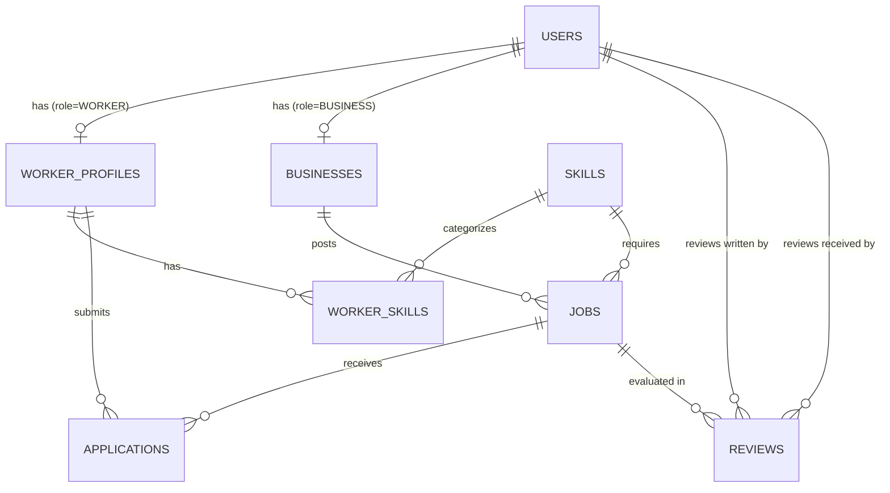

# KaamSetu — Database Schema & Architecture Specification

> **Database Engine:** PostgreSQL 15+  
> **Key Extensions:** `uuid-ossp` or `pgcrypto` (UUID generation), optional `cube` + `earthdistance` or standard Haversine mathematical function for distance indexing.

---

## 1. Entity Relationship Diagram (ERD)



---

## 2. PostgreSQL Data Definition Language (DDL)

```sql
-- Enable UUID generation
CREATE EXTENSION IF NOT EXISTS "uuid-ossp";

-- 1. ENUM TYPES
CREATE TYPE user_role AS ENUM ('WORKER', 'BUSINESS', 'ADMIN');
CREATE TYPE availability_status AS ENUM ('AVAILABLE_TODAY', 'AVAILABLE_TOMORROW', 'UNAVAILABLE');
CREATE TYPE job_status AS ENUM ('OPEN', 'FILLED', 'IN_PROGRESS', 'COMPLETED', 'CANCELLED');
CREATE TYPE application_status AS ENUM ('APPLIED', 'ACCEPTED', 'REJECTED', 'WITHDRAWN');

-- 2. USERS TABLE (Core Authentication & Identity)
CREATE TABLE users (
    id UUID PRIMARY KEY DEFAULT uuid_generate_v4(),
    phone VARCHAR(15) UNIQUE NOT NULL,
    name VARCHAR(100) NOT NULL,
    role user_role NOT NULL,
    is_active BOOLEAN DEFAULT TRUE,
    created_at TIMESTAMP WITH TIME ZONE DEFAULT CURRENT_TIMESTAMP,
    updated_at TIMESTAMP WITH TIME ZONE DEFAULT CURRENT_TIMESTAMP
);

CREATE INDEX idx_users_phone ON users(phone);
CREATE INDEX idx_users_role ON users(role);

-- 3. SKILLS MASTER TABLE
CREATE TABLE skills (
    id UUID PRIMARY KEY DEFAULT uuid_generate_v4(),
    name VARCHAR(80) UNIQUE NOT NULL,
    category VARCHAR(50) DEFAULT 'GENERAL', -- 'HOSPITALITY', 'RETAIL', 'LOGISTICS', 'MANUAL'
    icon_name VARCHAR(50) DEFAULT 'briefcase',
    created_at TIMESTAMP WITH TIME ZONE DEFAULT CURRENT_TIMESTAMP
);

-- 4. WORKER PROFILES
CREATE TABLE worker_profiles (
    user_id UUID PRIMARY KEY REFERENCES users(id) ON DELETE CASCADE,
    city VARCHAR(80) NOT NULL,
    locality VARCHAR(120),
    latitude DOUBLE PRECISION NOT NULL,
    longitude DOUBLE PRECISION NOT NULL,
    experience_years NUMERIC(3, 1) DEFAULT 0,
    expected_wage NUMERIC(10, 2) NOT NULL, -- in INR / day
    availability availability_status DEFAULT 'AVAILABLE_TODAY',
    rating NUMERIC(2, 1) DEFAULT 5.0,
    rating_count INTEGER DEFAULT 0,
    jobs_completed INTEGER DEFAULT 0,
    attendance_rate NUMERIC(4, 1) DEFAULT 100.0,
    created_at TIMESTAMP WITH TIME ZONE DEFAULT CURRENT_TIMESTAMP,
    updated_at TIMESTAMP WITH TIME ZONE DEFAULT CURRENT_TIMESTAMP
);

CREATE INDEX idx_workers_location ON worker_profiles(latitude, longitude);
CREATE INDEX idx_workers_availability ON worker_profiles(availability);

-- 5. WORKER SKILLS (M:N Mapping)
CREATE TABLE worker_skills (
    worker_id UUID REFERENCES worker_profiles(user_id) ON DELETE CASCADE,
    skill_id UUID REFERENCES skills(id) ON DELETE CASCADE,
    PRIMARY KEY (worker_id, skill_id)
);

CREATE INDEX idx_worker_skills_skill ON worker_skills(skill_id);

-- 6. BUSINESSES PROFILE
CREATE TABLE businesses (
    user_id UUID PRIMARY KEY REFERENCES users(id) ON DELETE CASCADE,
    business_name VARCHAR(150) NOT NULL,
    business_type VARCHAR(80) NOT NULL, -- e.g., 'Restaurant', 'Kirana Store', 'Warehouse'
    address TEXT NOT NULL,
    city VARCHAR(80) NOT NULL,
    locality VARCHAR(120),
    latitude DOUBLE PRECISION NOT NULL,
    longitude DOUBLE PRECISION NOT NULL,
    rating NUMERIC(2, 1) DEFAULT 5.0,
    rating_count INTEGER DEFAULT 0,
    jobs_posted INTEGER DEFAULT 0,
    jobs_completed INTEGER DEFAULT 0,
    created_at TIMESTAMP WITH TIME ZONE DEFAULT CURRENT_TIMESTAMP,
    updated_at TIMESTAMP WITH TIME ZONE DEFAULT CURRENT_TIMESTAMP
);

CREATE INDEX idx_business_location ON businesses(latitude, longitude);

-- 7. JOBS
CREATE TABLE jobs (
    id UUID PRIMARY KEY DEFAULT uuid_generate_v4(),
    business_id UUID NOT NULL REFERENCES businesses(user_id) ON DELETE CASCADE,
    skill_id UUID NOT NULL REFERENCES skills(id) ON DELETE RESTRICT,
    title VARCHAR(150) NOT NULL,
    description TEXT,
    workers_required INTEGER NOT NULL DEFAULT 1 CHECK (workers_required >= 1),
    workers_accepted INTEGER NOT NULL DEFAULT 0,
    wage NUMERIC(10, 2) NOT NULL CHECK (wage > 0), -- in INR / day
    food_provided BOOLEAN DEFAULT FALSE,
    job_date DATE NOT NULL,
    start_time TIME NOT NULL,
    end_time TIME NOT NULL,
    locality VARCHAR(120),
    latitude DOUBLE PRECISION NOT NULL,
    longitude DOUBLE PRECISION NOT NULL,
    status job_status DEFAULT 'OPEN',
    created_at TIMESTAMP WITH TIME ZONE DEFAULT CURRENT_TIMESTAMP,
    updated_at TIMESTAMP WITH TIME ZONE DEFAULT CURRENT_TIMESTAMP
);

CREATE INDEX idx_jobs_status ON jobs(status);
CREATE INDEX idx_jobs_skill_date ON jobs(skill_id, job_date);
CREATE INDEX idx_jobs_location ON jobs(latitude, longitude);

-- 8. APPLICATIONS
CREATE TABLE applications (
    id UUID PRIMARY KEY DEFAULT uuid_generate_v4(),
    job_id UUID NOT NULL REFERENCES jobs(id) ON DELETE CASCADE,
    worker_id UUID NOT NULL REFERENCES worker_profiles(user_id) ON DELETE CASCADE,
    status application_status DEFAULT 'APPLIED',
    worker_confirmed_completed BOOLEAN DEFAULT FALSE,
    business_confirmed_completed BOOLEAN DEFAULT FALSE,
    applied_at TIMESTAMP WITH TIME ZONE DEFAULT CURRENT_TIMESTAMP,
    updated_at TIMESTAMP WITH TIME ZONE DEFAULT CURRENT_TIMESTAMP,
    CONSTRAINT uq_job_worker UNIQUE (job_id, worker_id)
);

CREATE INDEX idx_applications_job ON applications(job_id);
CREATE INDEX idx_applications_worker ON applications(worker_id);

-- 9. REVIEWS & RATINGS
CREATE TABLE reviews (
    id UUID PRIMARY KEY DEFAULT uuid_generate_v4(),
    job_id UUID NOT NULL REFERENCES jobs(id) ON DELETE CASCADE,
    from_user_id UUID NOT NULL REFERENCES users(id) ON DELETE RESTRICT,
    to_user_id UUID NOT NULL REFERENCES users(id) ON DELETE RESTRICT,
    rating INTEGER NOT NULL CHECK (rating >= 1 AND rating <= 5),
    feedback_tag VARCHAR(50), -- e.g., 'Punctual', 'Polite', 'Quick Learner', 'Paid On Time'
    comment TEXT,
    created_at TIMESTAMP WITH TIME ZONE DEFAULT CURRENT_TIMESTAMP,
    CONSTRAINT uq_review_direction UNIQUE (job_id, from_user_id, to_user_id)
);

CREATE INDEX idx_reviews_to_user ON reviews(to_user_id);
```

---

## 3. Geospatial Matching Function (Pure SQL Haversine)

For lightweight V1 deployment without requiring GIS infrastructure or third-party paid location APIs, distances are calculated using standard Haversine spherical math (unit: kilometers, Earth radius = 6371 km):

```sql
-- Calculate distance between two coordinates in kilometers
CREATE OR REPLACE FUNCTION calculate_distance_km(
    lat1 DOUBLE PRECISION,
    lon1 DOUBLE PRECISION,
    lat2 DOUBLE PRECISION,
    lon2 DOUBLE PRECISION
)
RETURNS DOUBLE PRECISION AS $$
DECLARE
    dlat DOUBLE PRECISION;
    dlon DOUBLE PRECISION;
    a DOUBLE PRECISION;
    c DOUBLE PRECISION;
BEGIN
    dlat := radians(lat2 - lat1);
    dlon := radians(lon2 - lon1);
    
    a := sin(dlat / 2)^2 + cos(radians(lat1)) * cos(radians(lat2)) * sin(dlon / 2)^2;
    c := 2 * atan2(sqrt(a), sqrt(1 - a));
    
    RETURN 6371.0 * c;
END;
$$ LANGUAGE plpgsql IMMUTABLE;
```

### Core Matching Query for Worker Feed
```sql
SELECT 
    j.id,
    j.title,
    j.description,
    j.wage,
    j.food_provided,
    j.job_date,
    j.start_time,
    j.end_time,
    s.name AS skill_name,
    b.business_name,
    b.rating AS business_rating,
    b.jobs_completed AS business_completed_jobs,
    ROUND(calculate_distance_km($worker_lat, $worker_lon, j.latitude, j.longitude)::numeric, 1) AS distance_km,
    CASE WHEN a.id IS NOT NULL THEN a.status ELSE NULL END AS application_status
FROM jobs j
JOIN businesses b ON j.business_id = b.user_id
JOIN skills s ON j.skill_id = s.id
LEFT JOIN applications a ON a.job_id = j.id AND a.worker_id = $worker_id
WHERE j.status = 'OPEN'
  AND j.job_date >= CURRENT_DATE
  AND calculate_distance_km($worker_lat, $worker_lon, j.latitude, j.longitude) <= 5.0 -- 5km radius limit
ORDER BY distance_km ASC, j.wage DESC;
```

---

## 4. Default Seed Data Fixtures (Initial Skills & Pilot Records)

```sql
-- Insert Standard MVP Skills
INSERT INTO skills (name, category, icon_name) VALUES
    ('Restaurant Helper', 'HOSPITALITY', 'utensils'),
    ('Shop Helper', 'RETAIL', 'store'),
    ('Loading / Unloading', 'LOGISTICS', 'package'),
    ('Delivery Helper', 'LOGISTICS', 'truck'),
    ('Cleaner & Housekeeping', 'HOSPITALITY', 'sparkles'),
    ('General Construction Helper', 'MANUAL', 'hammer');
```
