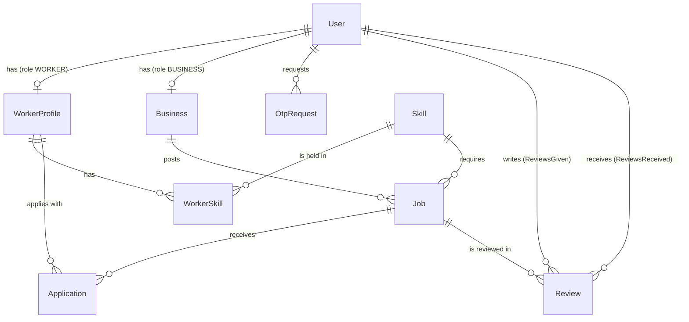

# KaamSetu Database

The schema is defined in [`prisma/schema.prisma`](prisma/schema.prisma). Prisma 5 with a SQLite datasource (`provider = "sqlite"`, `DATABASE_URL="file:./dev.db"` in `.env`). The schema file is the source of truth; this document describes it.

SQLite has no enums, so status and role values are plain `String` columns. The allowed values are defined as constants in `src/lib/status.ts` (`JOB_STATUS`, `APPLICATION_STATUS`, `USER_ROLE`, `AVAILABILITY`, `FEEDBACK_TAGS`). Routes and clients import those constants rather than typing literals.

Ids are UUID strings generated by Prisma (`@default(uuid())`). Money is stored as `Float` in INR. Dates that are calendar days (`jobDate`) and clock times (`startTime`, `endTime`) are strings: `YYYY-MM-DD` and `HH:MM`.

---

## 1. Entity relationships

---

## 2. Models

### User
The login identity. One row per phone number.

| Field | Type | Notes |
|---|---|---|
| `id` | String (uuid) | Primary key. |
| `phone` | String | Unique. The login key. |
| `name` | String | |
| `role` | String | Active role: `WORKER`, `BUSINESS` (or `ADMIN`, unused by routes). |
| `isActive` | Boolean | Default `true`. Inactive users are excluded from discovery. |

Relations: optional `WorkerProfile`, optional `Business`, `OtpRequest[]`, `Review[]` (given and received).

A user can hold both profiles, so one person can switch roles (`POST /me/role`).

### Skill
Master list of types of work.

| Field | Type | Notes |
|---|---|---|
| `name` | String | Unique display name. |
| `slug` | String | Unique. Stable key the client uses (`electrician`, `hospitality`, ...). |
| `category` | String | Grouping label, default `GENERAL`. |
| `iconName` | String | Icon key, default `briefcase`. |

Relations: `WorkerSkill[]`, `Job[]`. A skill referenced by a job cannot be deleted (`onDelete: Restrict`).

Seed slugs: `electrician`, `plumber`, `cleaner`, `painter`, `carpenter`, `helper`, `hospitality`, `general`, `construction`, `shop`, `delivery`.

### WorkerProfile
Worker-specific data. Primary key is `userId`, which is also the foreign key to `User`.

| Field | Type | Notes |
|---|---|---|
| `city`, `locality` | String | `locality` is optional. |
| `latitude`, `longitude` | Float | Exact home location. Public APIs return it rounded (`approximateCoord`). |
| `experienceYears` | Float | Default 0. |
| `expectedWage` | Float | Daily wage in INR. |
| `availability` | String | `AVAILABLE_TODAY` (default), `AVAILABLE_TOMORROW`, `UNAVAILABLE`. |
| `rating`, `ratingCount` | Float, Int | Recomputed from `Review` rows when a review is saved. Default 5.0 and 0. |
| `jobsCompleted` | Int | Incremented when both parties confirm completion. |
| `attendanceRate` | Float | Default 100. Stored, not yet exposed by the API. |

Relations: `WorkerSkill[]` (skills), `Application[]`.

### WorkerSkill
Join table between `WorkerProfile` and `Skill`. Composite primary key `(workerId, skillId)`. Both sides cascade on delete.

### Business
Business profile. Primary key is `userId`.

| Field | Type | Notes |
|---|---|---|
| `businessName`, `businessType`, `address`, `city` | String | `businessType` is free text, for example "Restaurant". |
| `locality` | String? | |
| `latitude`, `longitude` | Float | |
| `rating`, `ratingCount` | Float, Int | As for workers. |
| `jobsPosted`, `jobsCompleted` | Int | Counters. |

Relations: `Job[]`.

### Job
A posting by a business for one type of work on one day.

| Field | Type | Notes |
|---|---|---|
| `businessId` | String | FK to `Business.userId`. Cascade delete. |
| `skillId` | String | FK to `Skill`. Restrict delete. |
| `title`, `description` | String | |
| `workersRequired` | Int | Default 1. Max 20 via API validation. |
| `workersAccepted` | Int | Default 0. Incremented atomically by `acceptApplication`. |
| `wage` | Float | Daily wage in INR (API accepts 300 to 5000). |
| `foodProvided` | Boolean | Default `false`. |
| `jobDate` | String | `YYYY-MM-DD`. |
| `startTime`, `endTime` | String | `HH:MM`. |
| `locality`, `latitude`, `longitude` | String?, Float, Float | Job site location. |
| `status` | String | See status values below. Default `OPEN`. |
| `invitedWorkerId` | String? | Set when the business hires a specific worker. The worker's application is auto-accepted on apply. |

Relations: `Application[]`, `Review[]`.

Index: `@@index([status, latitude, longitude])`, which serves the nearby query (status filter first, then the bounding box).

### Application
A worker's application to a job, and the state of the work once accepted.

| Field | Type | Notes |
|---|---|---|
| `jobId` | String | FK to `Job`. Cascade delete. |
| `workerId` | String | FK to `WorkerProfile.userId`. Cascade delete. |
| `status` | String | See status values below. Default `APPLIED`. |
| `arrivalOtp` | String? | 4-digit arrival code, set on acceptance. Never returned except via the business-only `arrival-code` route. |
| `arrivalOtpAttempts` | Int | Wrong attempts on `/start`. Reset on acceptance. |
| `startedAt` | DateTime? | Set when the worker enters the correct code. |
| `workerConfirmedAt` | DateTime? | Worker confirmed completion. |
| `businessConfirmedAt` | DateTime? | Business confirmed completion. |
| `completedAt` | DateTime? | Set when both confirmations are in. |
| `paymentConfirmedAt` | DateTime? | Business confirmed payment (after COMPLETED). |
| `appliedAt` | DateTime | Default now. |
| `updatedAt` | DateTime | Auto-updated. |

Constraints and indexes: `@@unique([jobId, workerId])` (one application per worker per job) and `@@index([workerId])`.

Completion is tracked per application by the three timestamps above. There are no boolean "confirmed" flags.

### Review
A rating from one user about the other party of a completed application.

| Field | Type | Notes |
|---|---|---|
| `jobId` | String | FK to `Job`. |
| `fromUserId`, `toUserId` | String | FK to `User` (two relations). |
| `rating` | Int | 1 to 5. |
| `feedbackTag` | String? | Key from `FEEDBACK_TAGS`, for example `PUNCTUAL`. |
| `comment` | String? | |
| `createdAt` | DateTime | |

Constraint: `@@unique([jobId, fromUserId, toUserId])`. Resubmitting updates the existing row (upsert).

### OtpRequest
One row per login code issued.

| Field | Type | Notes |
|---|---|---|
| `phone` | String | |
| `codeHash` | String | HMAC-SHA256 of `phone:code`, keyed by `AUTH_SECRET`. The plain code is never stored. |
| `attempts` | Int | Wrong attempts. |
| `expiresAt` | DateTime | 5 minutes after issue. |
| `consumedAt` | DateTime? | Set on successful verification. |
| `userId` | String? | Set once the code is consumed. `SetNull` on user delete. |

Index: `@@index([phone, createdAt])`, used for the resend cooldown and the hourly limit.

---

## 3. Status values

Values are stored as strings. Constants are in `src/lib/status.ts`.

### Application.status

| Value | Meaning | Next states |
|---|---|---|
| `APPLIED` | Worker applied; awaiting business decision. | `ACCEPTED`, `REJECTED`, `WITHDRAWN` |
| `ACCEPTED` | Accepted; arrival code issued; parties can see each other's phone. | `IN_PROGRESS` |
| `IN_PROGRESS` | Arrival code verified; work underway. | `COMPLETED` |
| `COMPLETED` | Both parties confirmed completion. Reviews allowed. | none |
| `REJECTED` | Job filled before this application was accepted. | none |
| `WITHDRAWN` | Worker withdrew while APPLIED. | `APPLIED` (re-apply) |

### Job.status

| Value | Meaning |
|---|---|
| `OPEN` | Accepting applications. |
| `FILLED` | `workersAccepted` reached `workersRequired`. |
| `IN_PROGRESS` | At least one worker has started. |
| `COMPLETED` | No ACCEPTED or IN_PROGRESS applications remain, and at least one is COMPLETED. |
| `CANCELLED` | Reserved. No route sets it yet. |

### User.role, WorkerProfile.availability

`USER_ROLE`: `WORKER`, `BUSINESS`. `AVAILABILITY`: `AVAILABLE_TODAY`, `AVAILABLE_TOMORROW`, `UNAVAILABLE`.

---

## 4. Nearby search

Used by `GET /workers/nearby` and `GET /jobs/nearby`. Two steps:

1. **Bounding-box prefilter (database).** `boundingBox(lat, lng, radiusKm)` in `src/lib/geo.ts` returns `minLat`, `maxLat`, `minLng`, `maxLng`. The query adds `latitude` / `longitude` range conditions. These are plain comparisons that use the indexes (the composite index on `Job` for jobs). The box is a superset of the search circle. Longitude width widens with latitude, using `cos(lat)` with a floor of 0.01 to avoid division blow-up near the poles.
2. **Exact distance (application).** `calculateDistanceKm(lat1, lon1, lat2, lon2)` computes the Haversine great-circle distance in kilometres, with Earth radius 6371 km, rounded to one decimal place. Rows outside `max_distance` are dropped. Jobs are sorted by distance, then higher wage first. Workers are capped at 200 results.

Haversine runs in JavaScript, not in SQL. SQLite has no trigonometry functions in the default build, so the bounding box is what keeps the candidate set small.

Privacy: worker coordinates are rounded with `approximateCoord` (about 110 m) before they leave the server.

---

## 5. Seeding and dev data

`prisma/seed.ts` (run with `npm run prisma:seed`) creates the skill master list and a set of demo workers and businesses in the pilot area (Amritsar). It clears existing reviews, OTP requests, applications and other seeded rows first, so re-running it resets the demo data.

---

## 6. Migrations and commands

| Task | Command |
|---|---|
| Create and apply a migration (development) | `npx prisma migrate dev` (or `npm run prisma:migrate`) |
| Push schema without a migration (quick prototyping) | `npm run prisma:push` |
| Regenerate the client | `npx prisma generate` |
| Seed | `npm run prisma:seed` |
| Inspect data | `npx prisma studio` |

---

## 7. Moving to PostgreSQL

SQLite is used for local development. The schema is written so that moving to PostgreSQL is a configuration change:

1. In `prisma/schema.prisma`, change the datasource to `provider = "postgresql"`.
2. Set `DATABASE_URL` to a `postgresql://` connection string.
3. Delete `prisma/migrations` (it was generated for SQLite) and run `npx prisma migrate dev --name init` to create a fresh PostgreSQL migration.
4. Run `npm run prisma:seed` against the new database.

Notes:
- Status and role columns are `String`. They can be converted to Prisma `enum` types at that point. Keep the values in `src/lib/status.ts` in sync.
- Calendar and time columns are stored as strings. A move to `DateTime` or `DateTime @db.Date` is optional but needs changes in the routes that read them.
- The Haversine step stays in application code, so no PostgreSQL extensions (`cube`, `earthdistance`, PostGIS) are required.
